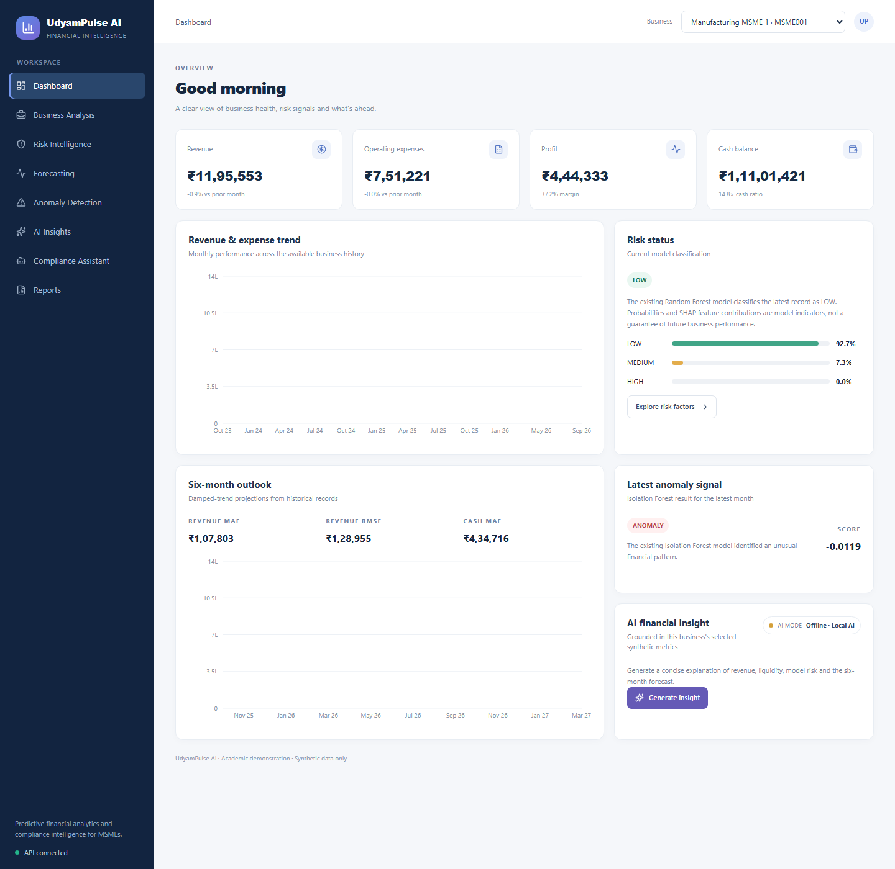
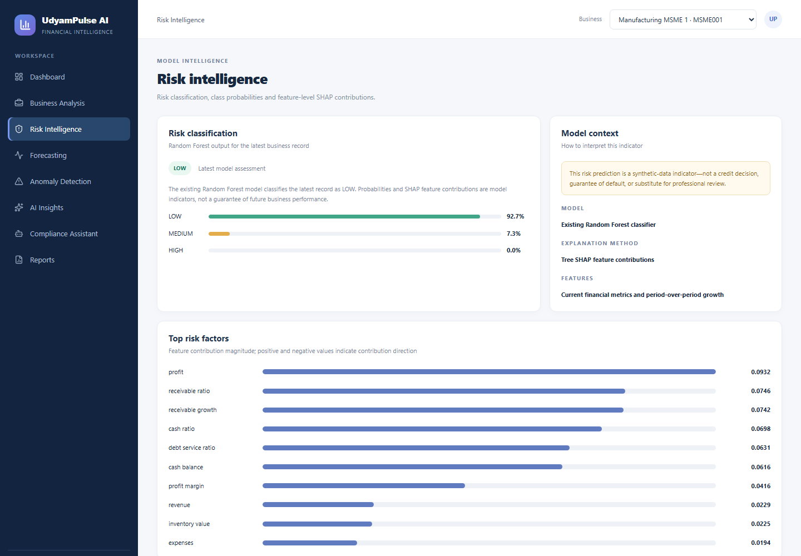
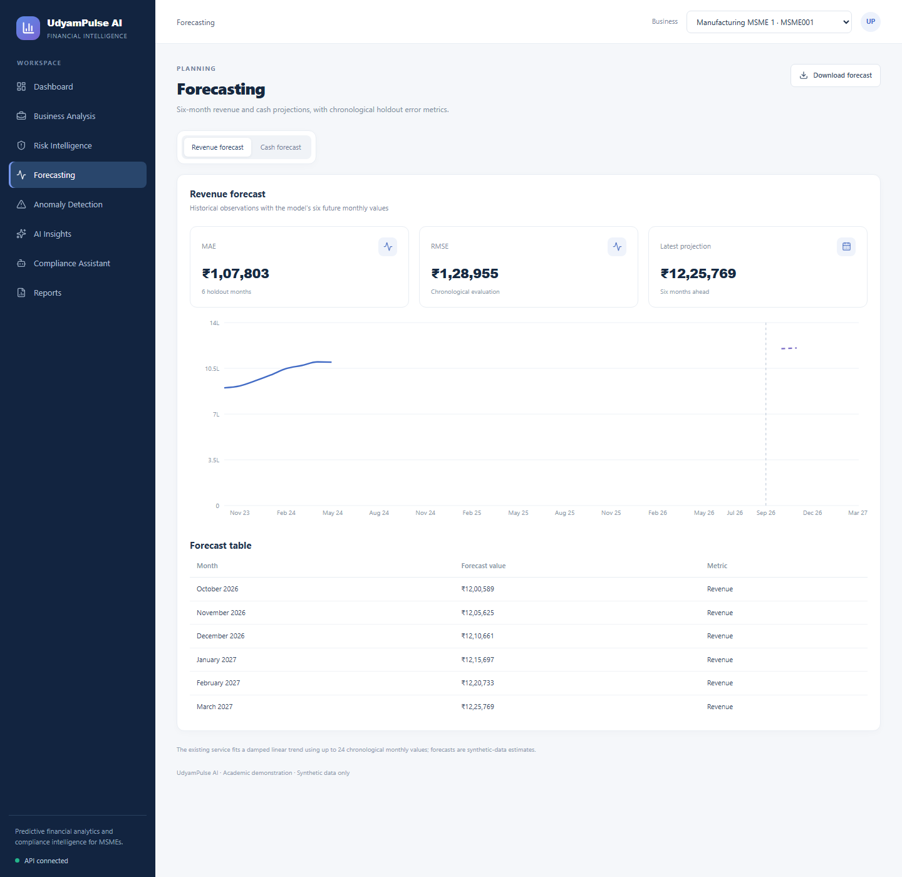
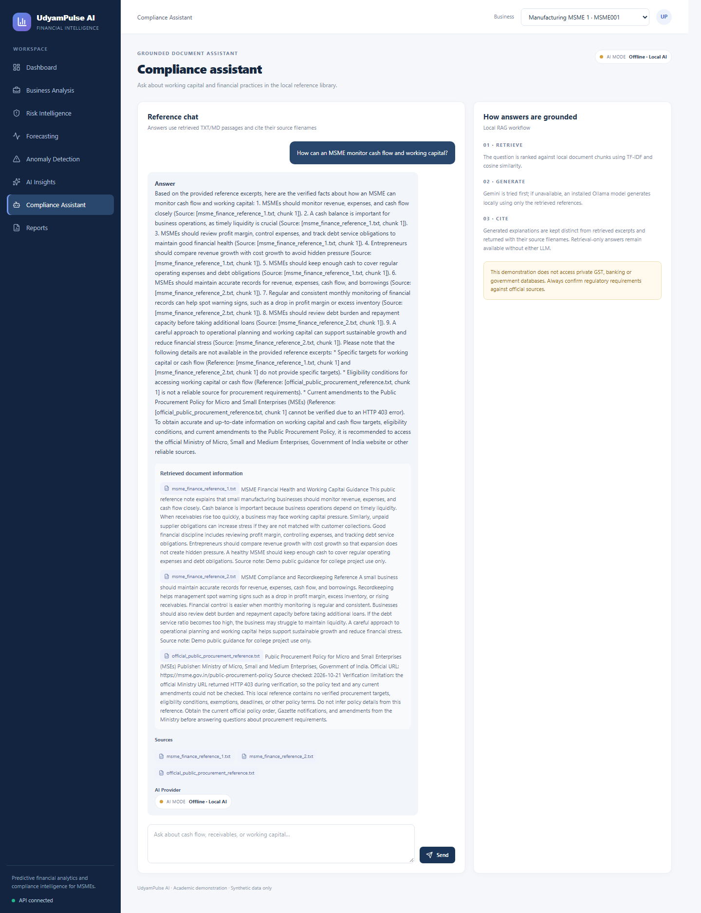

# UdyamPulse AI

**Predictive Financial Analytics & Compliance Intelligence Platform for MSMEs**

UdyamPulse AI is an academic decision-support prototype that brings synthetic MSME financial analytics, risk classification, forecasting, anomaly detection, model explanations, and local-document question answering into one web application.

> **Academic use only.** The included dataset is synthetic and the risk labels are rule-generated proxies, not observed credit outcomes. Metrics do not establish performance on real businesses. Do not use this application for lending, financial advice, or authoritative compliance decisions.

**Project:** B.Tech Computer Science and Engineering, Dayananda Sagar University

**Deployment:** No public deployment is configured.

## Contents

- [Problem and objectives](#problem-and-objectives)
- [Implemented features and stack](#implemented-features-and-stack)
- [Architecture and repository structure](#architecture-and-repository-structure)
- [Dataset and financial indicators](#dataset-and-financial-indicators)
- [Risk target, features, and evaluation](#risk-target-features-and-evaluation)
- [Forecasting, anomaly detection, and SHAP](#forecasting-anomaly-detection-and-shap)
- [Generative AI and document retrieval](#generative-ai-and-document-retrieval)
- [Screenshots](#screenshots)
- [API](#api)
- [Setup and configuration](#setup-and-configuration)
- [Reproducing the analysis](#reproducing-the-analysis)
- [Tests and verification](#tests-and-verification)
- [Limitations and future work](#limitations-and-future-work)

## Problem and objectives

MSME teams often need a concise view of revenue, expenses, cash, debt, and working-capital patterns. This prototype demonstrates how these indicators can be explored alongside:

- a transparent, rule-created future-stress target and a Random Forest classifier;
- six-month revenue and cash projections;
- unusual-pattern detection and feature-level model explanations; and
- retrieval of excerpts from a small local reference library.

The application is intended to make an academic workflow inspectable and reproducible, not to replace domain experts or verified financial and compliance systems.

## Implemented features and stack

| Area | Implementation |
|---|---|
| Web client | React 19, TypeScript, Vite 8, Tailwind CSS, Recharts, Lucide |
| API | Python, FastAPI, Pydantic |
| Data | Pandas, NumPy |
| Risk classification | Scikit-learn Random Forest |
| Anomaly detection | Scikit-learn `StandardScaler` and Isolation Forest |
| Explainability | Tree SHAP |
| Forecasting | Per-business damped linear trend |
| Text generation | Google Gen AI SDK; optional local Ollama |
| Document retrieval | Scikit-learn TF-IDF and cosine similarity |
| Tests | Python `unittest`; frontend Oxlint and TypeScript/Vite build |

The UI includes a dashboard, business analysis, risk intelligence, forecasting, anomaly detection, AI insights, compliance assistant, and CSV reports.

## Architecture and repository structure

The Vite client calls the FastAPI JSON API. The API combines the shared data/forecasting service, saved model artifacts, and AI/RAG services. Gemini and Ollama are optional generation providers; dataset analytics and local document retrieval are implemented locally.

```text
.
├── backend/
│   ├── main.py                         # FastAPI app and CORS configuration
│   ├── routes/api.py                   # /api routes and request models
│   └── services/analytics.py           # Model loading, inference, and SHAP
├── data/
│   ├── raw/msme_financial_data.csv      # Synthetic monthly input dataset
│   └── processed/                      # Targets, splits, and evaluation outputs
├── documents/                          # Local TXT references for the assistant
├── docs/screenshots/                   # Captures from the running local UI
├── frontend/
│   ├── package.json
│   └── src/
│       ├── App.tsx                     # Client routes
│       ├── pages/Pages.tsx              # Dashboard and feature pages
│       └── services/api.ts              # Browser API client
├── models/
│   ├── financial_risk_model.pkl
│   └── anomaly_detection_model.pkl
├── notebooks/                          # Numbered analysis and model scripts
├── services/
│   ├── data_service.py                 # Data, KPIs, target, and forecast
│   ├── ai_service.py                   # Provider orchestration and RAG
│   ├── local_llm_service.py            # Loopback Ollama integration
│   └── rag_service.py                  # Local document chunking/retrieval
├── tests/
├── generate_dataset.py
├── requirements.txt
└── OFFICIAL_SOURCES_CHECKLIST.md
```

The application entry point is `backend.main:app`. The backend loads `data/raw/msme_financial_data.csv` and the two model artifacts from `models/`; these files are present in this repository.

## Dataset and financial indicators

The tracked raw file, [`data/raw/msme_financial_data.csv`](data/raw/msme_financial_data.csv), contains **3,600 rows**: 100 synthetic business IDs with 36 monthly observations each, from October 2023 through September 2026. All records are in the Manufacturing sector. The generated records are not real business accounts.

Source columns include employee count, revenue, expenses, cash balance, receivables, payables, inventory, loan EMI, and outstanding loan. The KPI and feature calculations in [`services/data_service.py`](services/data_service.py) and [`notebooks/05_prepare_ml_dataset.py`](notebooks/05_prepare_ml_dataset.py) use these project-specific definitions:

| Indicator | Formula |
|---|---|
| Profit | Revenue − expenses |
| Profit margin (%) | Profit / revenue × 100 |
| Revenue growth (%) | (current revenue − previous-month revenue) / previous-month revenue × 100 |
| Expense growth (%) | (current expenses − previous-month expenses) / previous-month expenses × 100 |
| Working capital | Receivables + inventory value − payables |
| Cash ratio | Cash balance / current-period expenses |
| Receivable ratio | Receivables / revenue |
| Payable ratio | Payables / expenses |
| Debt-service ratio | Loan EMI / revenue |
| Inventory ratio | Inventory value / revenue |

Here, **cash ratio** is the implementation's project-specific name for cash balance divided by expenses; it is not asserted to be a standard accounting cash-ratio definition.

## Risk target, features, and evaluation

### Target definition

[`services/data_service.py`](services/data_service.py) implements `create_risk_target`; [`notebooks/04_risk_target_design.py`](notebooks/04_risk_target_design.py) calls it with a fixed three-month horizon. For a business at month *t*, it averages the corresponding indicator for *t+1*, *t+2*, and *t+3*. The future indicators are used to create the label, not supplied to the model as features.

```text
future_mean(x) = mean(x[t+1], x[t+2], x[t+3])

flag_profit       = future_mean(profit_margin) < 10%
flag_cash_decline = (future_mean(cash_balance) - cash_balance[t])
                    / cash_balance[t] * 100 < -15%
flag_revenue_drop = (future_mean(revenue) - revenue[t])
                    / revenue[t] * 100 < -10%
flag_receivables  = future_mean(accounts_receivable / revenue) > 0.30
flag_debt_service = future_mean(loan_emi / revenue) > 0.12

stress_score = sum(the five flags)
LOW    = 0 flags
MEDIUM = 1 flag
HIGH   = 2 or more flags
```

The inequalities are strict: a value exactly at a threshold does not trigger that flag. The thresholds are hard-coded in the target function; only the horizon is a function argument, and the target-generation script currently supplies `3`. Records without the required future averages are dropped, so the final three observations per business cannot be labeled. The target-generation notebook checks for duplicate business-month records and consecutive monthly observations. There is no separate target class for a zero denominator: the change formulas divide by current cash and revenue directly. The current synthetic data has no zero revenue, expense, or cash denominators.

These deterministic labels represent the project's future-stress rules, not default, insolvency, or externally validated risk categories.

### Features and leakage controls

The model uses the following **21 current-month features**, in the same order during training and API inference:

```text
employee_count, revenue, expenses, cash_balance, accounts_receivable,
accounts_payable, inventory_value, loan_emi, loan_outstanding,
profit, profit_margin, working_capital, cash_ratio, receivable_ratio,
payable_ratio, debt_service_ratio, inventory_ratio,
revenue_growth, expense_growth, cash_growth, receivable_growth
```

Raw financial values are from month *t*. Profit, margin, working capital, and the ratios use the formulas above; growth features compare the current month with the preceding row for the same business. Neither future target measures nor `risk_label`, `risk_target`, or other target-generation columns are in the selected feature list. The preparation and evaluation scripts explicitly reject future/target-named features. The inference list in [`backend/services/analytics.py`](backend/services/analytics.py) matches the training feature names and ordering.

For ordinary values in the included dataset, training and inference use the same feature definitions. One edge case remains for future data: training converts non-finite engineered feature values to missing and drops affected rows, while API inference substitutes `0.0` for a missing or zero denominator in ratio calculations. The current input dataset has no zero denominators, so this difference did not affect the reported evaluation; it should be reconciled before using other data.

### Time split and model selection

[`notebooks/05_prepare_ml_dataset.py`](notebooks/05_prepare_ml_dataset.py) sorts by calendar month and creates an 80/20 chronological split, then purges three boundary months so training target windows end before later feature periods. The current [`ml_train.csv`](data/processed/ml_train.csv) and [`ml_test.csv`](data/processed/ml_test.csv) contain:

| Partition | Period | Records | Use |
|---|---|---:|---|
| Model-fitting subset for validation | Nov 2023–Dec 2024 | 1,400 | Fit each candidate |
| Purged validation-boundary months | Jan–Mar 2025 | 300 | Excluded from candidate fitting |
| Validation | Apr–Aug 2025 | 500 | Select candidate |
| Final training file | Nov 2023–Aug 2025 | 2,200 | Refit selected candidate |
| Purged test-boundary months | Sep–Nov 2025 | 300 | Excluded at train/test boundary |
| Final test | Dec 2025–Jun 2026 | 700 | Final held-out evaluation |

Each month has 100 business records. The three-month gap is implemented by calendar-month comparisons in the preparation and evaluation scripts, not by a row-level random split. The evaluation script separately checks that the latest training target window precedes validation/test features.

[`notebooks/07_evaluate_risk_model.py`](notebooks/07_evaluate_risk_model.py) compares three Random Forest configurations on the validation partition. Selection sorts by HIGH-risk recall first and macro F1 second; the **Baseline Balanced** candidate was selected. The selected model is then refit on all 2,200 rows in the final training file. The final test partition is not used in candidate selection.

| Validation candidate | Accuracy | Macro F1 | HIGH recall |
|---|---:|---:|---:|
| Baseline Balanced (selected) | 0.8200 | 0.7441 | 0.5918 |
| Stronger High Risk | 0.8440 | 0.7656 | 0.5714 |
| High Risk Emphasis | 0.8440 | 0.7610 | 0.5510 |

The validation values come from [`model_comparison.csv`](data/processed/model_comparison.csv). The saved final model is a Random Forest with 200 trees, `max_depth=10`, `class_weight="balanced"`, and `random_state=42`.

### Final test results

The following metrics were reproduced from [`financial_risk_model.pkl`](models/financial_risk_model.pkl) against [`ml_test.csv`](data/processed/ml_test.csv), using the metric definitions in the evaluation script. The final test metrics are printed by that script rather than saved as a dedicated report file.

| Metric | Final test |
|---|---:|
| Test records | 700 |
| Accuracy | 90.57% |
| Macro F1 | 0.8309 |
| HIGH-risk recall | 57.50% |
| Actual HIGH records | 80 |
| HIGH records predicted as HIGH | 46 |
| Actual HIGH records missed | 34 |

Confusion matrix (rows are actual labels; columns are predicted labels):

| Actual \ Predicted | LOW | MEDIUM | HIGH |
|---|---:|---:|---:|
| LOW | 406 | 14 | 0 |
| MEDIUM | 7 | 182 | 11 |
| HIGH | 0 | 34 | 46 |

Accuracy alone hides the missed HIGH cases. These measurements describe this synthetic, rule-labeled test split only; they do not establish real-world risk performance.

## Forecasting, anomaly detection, and SHAP

### Forecasting

[`services/data_service.py`](services/data_service.py) fits revenue and cash balance **separately for each business**, using up to the 24 latest finite monthly observations. It fits a linear slope with `numpy.polyfit`, applies a 0.75 dampening factor from the last observed value, and clamps forecasts to zero or above. At least two valid historical values are required. The API returns six future monthly values for each series.

Holdout evaluation is chronological: the last `min(6, number_of_rows // 4)` available observations are held out, and the trend is fit only on earlier values. If there is insufficient history, the service returns unavailable (`NaN`) metrics with zero holdout months. For **MSME001**, the current six-month holdout evaluation is:

| Series | Holdout months | MAE | RMSE |
|---|---:|---:|---:|
| Revenue | 6 | Rs 107,802.78 | Rs 128,955.36 |
| Cash balance | 6 | Rs 434,716.11 | Rs 472,643.82 |

These are one synthetic business's chronological holdout errors, not an aggregate across businesses. The service output is reproducible with `evaluate_forecast` in [`services/data_service.py`](services/data_service.py).

### Anomaly detection

The saved [`anomaly_detection_model.pkl`](models/anomaly_detection_model.pkl) is used to score the 21 financial features. The training script [`notebooks/09_anomaly_detection.py`](notebooks/09_anomaly_detection.py) fits a `StandardScaler` followed by an Isolation Forest with 200 trees, `contamination=0.05`, and `random_state=42`, using the training partition. Prediction `-1` is returned as `ANOMALY`; `1` is `NORMAL`. The API also returns the decision-function score and the input indicators. This flags an unusual pattern, not confirmed financial distress; the configured contamination is a modeling assumption, not a measured distress rate.

### SHAP explanations

`AnalyticsService` applies `shap.TreeExplainer` to the saved Random Forest and the latest business record. The API returns the top 10 feature contributions for the predicted class, sorted by absolute contribution magnitude. Each entry contains the feature name, contribution value, and absolute impact. SHAP describes how the fitted model responds to its inputs; it does not establish causation or validate the underlying label.

## Generative AI and document retrieval

### Financial summaries

The backend uses the Google Gen AI SDK (`google-genai`) and defaults to `gemini-3.5-flash-lite`, configurable with `GEMINI_MODEL`. The financial summary workflow is:

1. Gemini, if `GEMINI_API_KEY` is configured and the request succeeds.
2. A local Ollama model, if it is installed, running, and has the configured model.
3. A deterministic local financial summary if neither generator returns an answer.

Gemini retries a retryable 429/503 once only when its retry delay is at most two seconds. Missing credentials, quota/rate limits, network failures, and provider errors fall through to the next option. Ollama uses `http://127.0.0.1:11434`; `OLLAMA_MODEL` defaults to `llama3.2:3b`. No provider secret is returned by the status API or belongs in frontend `VITE_*` variables.

### Compliance assistant (local RAG)

[`services/rag_service.py`](services/rag_service.py) reads `.txt` and `.md` files directly from `documents/`, splits text into 160-word chunks with 30-word overlap, and ranks them using TF-IDF with English stop words and cosine similarity. It returns up to three positive-similarity passages. The sources and retrieved snippets are returned separately from the answer.

For retrieved passages, answer generation tries Gemini, then Ollama. If neither is available, the assistant returns a retrieval-only explanation and the actual retrieved excerpts. If no relevant passage is found, it returns no sources and does not invoke a generator. The source attribution is based on filenames/chunks; similarity and generated citations do not prove that a source is official, current, complete, or legally authoritative.

The local library includes [`msme_finance_reference_1.txt`](documents/msme_finance_reference_1.txt), [`msme_finance_reference_2.txt`](documents/msme_finance_reference_2.txt), and four named scheme/policy references. Verification limitations for some scheme details are recorded in [`OFFICIAL_SOURCES_CHECKLIST.md`](OFFICIAL_SOURCES_CHECKLIST.md). Check current requirements with the relevant authoritative source before relying on them.

## Screenshots

These screenshots were captured from the running local application with the included synthetic data on 21 October 2026. The compliance view shows a real local query and the passages/source filenames returned by the assistant.

### Dashboard



### Business risk and SHAP



### Six-month forecasting



### Compliance assistant



## API

The router in [`backend/routes/api.py`](backend/routes/api.py) is mounted at `/api`. Interactive OpenAPI documentation is available at `/docs` while the backend is running.

| Method | Endpoint | Purpose |
|---|---|---|
| `GET` | `/api/health` | API and dataset readiness; reports whether Gemini is configured |
| `GET` | `/api/ai/status` | Gemini configuration, local Ollama readiness, and retrieval availability |
| `GET` | `/api/businesses` | Latest selector record for each business |
| `GET` | `/api/business/{business_id}` | Latest record and monthly history |
| `GET` | `/api/business/{business_id}/kpis` | Latest financial record and derived KPIs |
| `GET` | `/api/business/{business_id}/risk` | Risk label, class probabilities, and explanation |
| `GET` | `/api/business/{business_id}/anomaly` | Anomaly status, prediction, score, and indicators |
| `GET` | `/api/business/{business_id}/shap` | Top 10 model feature contributions |
| `GET` | `/api/business/{business_id}/forecast` | Six-month revenue/cash forecasts and holdout metrics |
| `POST` | `/api/ai/summary` | Financial summary; JSON body: `{"business_id":"MSME001"}` |
| `POST` | `/api/compliance/query` | Local-reference question; JSON body: `{"question":"..."}` |

## Setup and configuration

### Requirements

- **Python 3.11 or newer.** There is no separate Python-version pin; `scikit-learn==1.8.0` declares Python `>=3.11`. The current checks used Python 3.13.2.
- **Node.js `^20.19.0 || >=22.12.0`** for the locked Vite 8 toolchain. The current checks used Node 24.19.0.
- npm, installed with Node.js.
- The tracked dataset and model files listed above.

### Install and start locally

In a Windows PowerShell terminal at the repository root:

```powershell
python -m venv .venv
.\.venv\Scripts\Activate.ps1
python -m pip install -r requirements.txt
python -m uvicorn backend.main:app --reload --host 127.0.0.1 --port 8000
```

In a second PowerShell terminal:

```powershell
Set-Location .\frontend
npm ci
npm run dev
```

Open the Vite URL shown in the terminal (normally `http://localhost:5173`). The API defaults to `http://localhost:8000`; set `VITE_API_URL` before starting Vite if the backend uses another address. The API's default CORS origins are `http://localhost:5173` and `http://127.0.0.1:5173`; configure `CORS_ORIGINS` on the backend if needed.

### Optional provider configuration

Core KPIs, saved-model predictions, forecasts, and local retrieval do not require Gemini credentials. Optional backend settings are:

| Variable | Purpose | Default |
|---|---|---|
| `GEMINI_API_KEY` | Enables Gemini requests from the backend | Unset |
| `GEMINI_MODEL` | Gemini model name | `gemini-3.5-flash-lite` |
| `OLLAMA_MODEL` | Installed local Ollama model | `llama3.2:3b` |
| `CORS_ORIGINS` | Comma-separated allowed frontend origins | Local Vite origins above |
| `VITE_API_URL` | Frontend API base URL | `http://localhost:8000` |

Set credentials only in the backend environment or a private, Git-ignored root `.env` file. The root `.gitignore` excludes `.env`. Never commit credentials or put backend secrets in frontend variables.

For optional Ollama generation, install and run Ollama separately and pull the configured model, for example `ollama pull llama3.2:3b`. The application does not download language models. If no language model is available, financial summaries use deterministic local analysis and compliance queries can return retrieved passages without generated answers.

## Reproducing the analysis

The numbered Python scripts in [`notebooks/`](notebooks/) run from the repository root in sequence:

```powershell
python notebooks\01_eda_and_validation.py
python notebooks\02_financial_eda.py
python notebooks\03_kpi_engine_test.py
python notebooks\04_risk_target_design.py
python notebooks\05_prepare_ml_dataset.py
python notebooks\06_train_risk_model.py
python notebooks\07_evaluate_risk_model.py
python notebooks\08_shap_explanation.py
python notebooks\09_anomaly_detection.py
python notebooks\10_validate_anomalies.py
python notebooks\11_forecasting.py
python notebooks\12_generative_ai.py
python notebooks\13_rag_assistant.py
```

These scripts write or replace derived outputs under `data/processed/` and model artifacts under `models/`; inspect those outputs before rerunning the pipeline. The AI examples may use configured providers, while the analytics and retrieval scripts use local project data.

## Tests and verification

From the repository root, run the Python tests:

```powershell
python -m unittest discover -s tests -v
```

From `frontend/`, run:

```powershell
npm run lint
npm run build
```

**Verified in this checkout:** all 29 Python unit/API tests passed; frontend lint completed successfully; the production TypeScript/Vite build completed successfully. Provider tests use mocks for external generation, so they do not establish live Gemini availability.

## Limitations and future work

- All included financial records and business identifiers are synthetic; there is no evaluation on real MSME outcomes.
- Threshold-derived labels are a modeling exercise, not established credit-risk classes. HIGH recall on the held-out synthetic test set is 57.5%, with 34 of 80 HIGH records missed.
- Forecasting is a simple trend baseline; anomaly flags are unusual-pattern indicators, not diagnoses.
- SHAP contributions are explanations of model behavior, not causal effects.
- Language-model output may be incorrect. Local RAG is limited to the included documents and does not browse the web or private databases.
- Some scheme/policy references have documented verification gaps; retrieved content is not automatically authoritative or current.
- The API has no authentication or user-specific data isolation and should not be exposed to untrusted users as configured.
- Before broader use, reconcile train/inference denominator handling, validate on appropriately governed real data, assess data drift and subgroup performance, improve HIGH recall, and verify official references.
